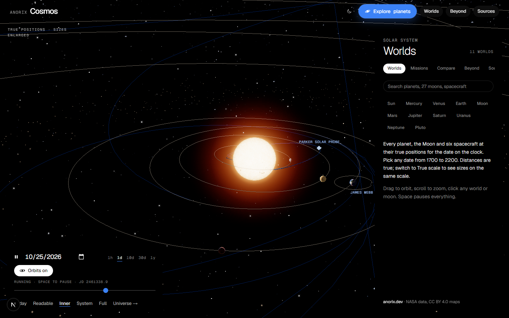

# Anorix Cosmos

An interactive 3D solar system in the browser. Every planet, the major moons and six spacecraft sit at their real positions for the date on the clock, from 1700 to 2200. Click any world to fly to it and open its dossier.



## Features

- **True positions.** Planets and the Moon come from `astronomy-engine`; spacecraft (Voyager 1 and 2, New Horizons, Juno, Parker Solar Probe, JWST) follow JPL Horizons vector tables.
- **Time control.** Play, pause and scrub from 1700 to 2200 at 1 h to 1 y per second, or jump back to today. Space pauses everything.
- **Readable or true scale.** Sizes are enlarged by default so small worlds stay visible; switch to true scale to compare them honestly.
- **Dossiers.** Overview, history, a cut-away of the interior, notable features and a short formation sequence for each world, plus 27 moons with their own maps.
- **Missions, Compare and Beyond.** Spacecraft trails, side-by-side planet comparison, and a trip out to nearby stars, the Milky Way, Local Group galaxies and the 2MASS redshift survey.
- **Light and dark chrome**, keyboard shortcuts (O toggles orbits) and reduced-motion support.

## Run locally

Requires Node.js 20 or newer.

```bash
npm install
npm run dev          # http://localhost:3000
```

Production:

```bash
npm run build
npm start
```

`npm run lint` runs ESLint. `npx tsx scripts/check-orbits.ts` checks the Earth position against a reference date.

## Data sources and credits

| What | Source | License |
| --- | --- | --- |
| Planet, Sun, Moon and sky maps | [Solar System Scope](https://www.solarsystemscope.com/textures/) (based on NASA imagery) | CC BY 4.0 |
| Pluto and Charon maps | NASA / JHUAPL / SwRI (New Horizons) | Public domain |
| Moon maps (Io, Europa, Titan, …) | NASA / JPL / USGS / SSI via Wikimedia Commons | Public domain, except Ganymede (Björn Jónsson, attribution) and Deimos (CC BY-SA 3.0) |
| Mars and Moon relief | NASA PDS MGS MOLA, NASA SVS LRO LOLA | Public domain |
| Planet positions | [astronomy-engine](https://github.com/cosinekitty/astronomy) | MIT |
| Spacecraft trajectories, satellite elements | [JPL Horizons](https://ssd.jpl.nasa.gov/horizons/), [JPL SSD](https://ssd.jpl.nasa.gov/sats/elem/) | NASA public data |
| Physical numbers | [NASA NSSDCA fact sheets](https://nssdc.gsfc.nasa.gov/planetary/factsheet/) | NASA public data |
| Nearby stars | [HYG Database](https://github.com/astronexus/HYG-Database) | CC BY-SA 4.0 |
| Galaxy survey | 2MASS Redshift Survey, Huchra et al. 2012 (VizieR J/ApJS/199/26) | Public scientific data |
| Gaia sky, ESO and Hubble images | ESA/Gaia/DPAC, ESO, NASA/ESA/Hubble via Wikimedia Commons | CC BY 4.0 or public domain |

The full per-file list is in [`public/textures/LICENSE.txt`](public/textures/LICENSE.txt). NASA does not endorse this project.

## Stack

Next.js (App Router), React, TypeScript, three.js with React Three Fiber, drei and postprocessing.

## License

Code © 2026 Ahsan Javed / [Anorix](https://anorix.dev). All rights reserved unless a license file says otherwise. Third-party data and images keep their own licenses listed above.
